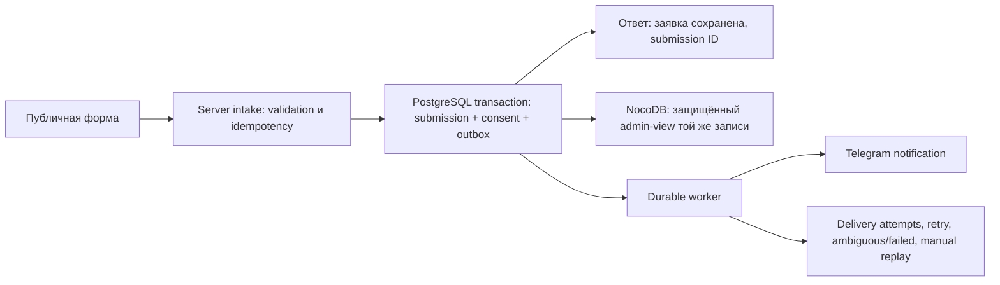

# Формы → PostgreSQL → CRM и Telegram

Обновлено **12.11.2026** (HEAD4a4eb01 + рабочее дерево; live delivery не повторялась). **Confirmed:** PostgreSQL +
NocoDB staff view + Telegram. **Cancelled (owner 09.11, 152-ФЗ):** lead export
в Google Sheets. Retail map spreadsheet — не destination лидов.
[Sources](../data/SOURCE_INVENTORY.md), [ADR database](../adr/0002-database.md),
[ADR jobs](../adr/0007-background-jobs.md), [план](../SPRINT_PLAN.md).

## Текущее состояние

B1 local Accepted09.11: Contacts RU → PostgreSQL → NocoDB. B2 Telegram delivery
ранее отмечена Done; B3 все формы и staff commands **реализованы**.
Сегодняшняя работоспособность внешних сервисов не проверялась.
**M2-2 текущий:** recovery/fencing/CRM race/grants/Telegram limits —
[ревью R01–R07](../reviews/2026-11-12-agent-crm-and-migration.md).
Lead Sheets не реализуется. Member receipt/agent application — отдельные
доменные команды: [AGENT_CRM_WORKFLOWS](AGENT_CRM_WORKFLOWS.md).

NocoDB читает те же business tables. Telegram — downstream; отказ доставки не
отменяет commit. Не отправлять из браузера.

## Матрица форм / назначений

| Сценарий / текущий компонент | Поля по коду | Отдельный контракт |
|---|---|---|
| contacts, RU | name/email/phone required; city/company/comment optional | Intake implemented; purpose contact |
| partnership RU/EN и russian-craft-beer (shared form_id) | type/company/city/name/email/phone, comment | B2B; общий form_id, страницы и локали различают sourcePath/locale |
| horeca, RU | city/company/name/inn/email/phone/comment | B2B; INN и required поля валидировать по согласованной схеме |
| catalog lead, RU/EN | name/email, comment | Product context — только если реально передан/подтверждён |
| tours request, RU/EN | name/phone/date/guests/email, wishes | Lead, **не подтверждённая бронь/оплата**, не замена YCLIENTS |
| newsletter home/blog, RU/EN | email | Отдельный marketing purpose/consent; source placement home/blog, locale |

Контракты реализованы в src/server/forms/contracts.ts: allowlisted locale,
purpose/legalBasis/policyVersion, fields и server limits; clients передают
consent evidence. UI остаётся разнородным: contacts/newsletter paragraph/link,
partnership checkbox зависит от copy/locale, tours/catalog без отдельного
control. Проверить соответствие фактически показанного notice сохранённому
evidence перед shared/live вводом. Marketing purpose отделён от B2B заявки;
не вводить одинаковый checkbox без содержательного решения.

## API и схема данных — реализованный фундамент и обязательные инварианты

- Один server-only intake service; действующий POST /api/forms/submissions,
  вне locale-specific JSX. Client schema — удобство, server schema — контроль.
- Envelope: schema_version, allowlisted form_id, locale, source_path/placement,
  idempotency_key, типизированные fields, consent evidence. Не доверять присланным
  chat IDs, Sheet IDs, webhook URLs или business statuses: routing только server-side.
- Allowlist — для включённой пары form_id/locale/schema/consent version.
  Одна глобальная published locale не разрешает отсутствующую локализованную форму.
- Ограничения размера/длины и неизвестных полей; обязательность/формат email,
  phone, числа гостей/даты по конкретному сценарию. Rate limit/anti-abuse,
  Origin/CSRF policy по фактической auth-модели, honeypot/порог — по необходимости.
- Не создавать user/agent account и не сливать разные заявки по email/phone.
  Идентичность лида и участника программы — разные задачи.

Минимальные сущности: form_submissions, submission_consents, delivery_jobs,
delivery_attempts и sanitized audit/events. Payload может быть validated JSONB
с versioned form schema и индексируемыми общими полями; не складывать arbitrary
JSON без валидации. Schema/индексы уже версионируются SQL; retention/delete policy довести до эксплуатации.

**Одна транзакция:** уникальность intent/key + payload hash → submission + consent
evidence + outbox events. Same key/same payload возвращает прежний submission ID;
same key/different payload — конфликт. Проверить concurrent repeats. Новый осознанный
запрос может иметь тот же email: это не дубль старой заявки.

Hash считать от canonical normalized immutable intent (form/schema/locale/
fields/consent version): стабильный порядок keys, согласованная нормализация
optional empty значений. Server created_at/request IDs/attempt times и меняющийся
routing не входят в сравнение intent. Intent key сохраняется при retry.

Ответ accepted, например HTTP 202, только **после commit**: submission ID и
машиночитаемый статус без PII. UI означает «заявка сохранена», не «Telegram
уже доставил». Invalid/rate-limit/DB failure имеют разные error codes;
ввод сохраняется. При потере ответа retry использует тот же intent key,
а не создаёт новую заявку. Public GET по ID не должен открывать чужие данные.

## Админка и права

NocoDB self-hosted обязателен; metadata DB изолирована от business DB, отдельная
ограниченная PG роль. Public frontend не получает service token/PG credentials;
staff NocoDB UI использует собственную авторизованную сессию. Проверить version/edition, external PG и UI roles
на выбранной сборке. Не предполагать бесплатную доступность SSO/audit/RLS.
Первый CRM view read-only: filters/search по необходимым полям; private staff
access, без публичного shared view. Проверить вход read-only manager account.

Application владеет миграциями. UI schema edit выключен; outbox/attempts/audit/
будущий ledger не редактируются менеджером. Нельзя дать произвольную DB роль
только потому, что в NocoDB убрали кнопку. По текущей документации data edit
включён по умолчанию, schema edit выключен: выставить нужный режим явно.
[NocoDB permissions](https://nocodb.com/docs/product/integrations/data-sources/connect-to-data-source).

Triage/assignment/status/comments — через проверенные commands и audit.
**Implemented (local):** `/staff` UI + `/api/staff/*` с `STAFF_API_TOKEN`,
`workflow_status` / `assignee` / `staff_note`, append-only `app.staff_lead_events`,
controlled delivery replay (failed/blocked/retry/ambiguous → pending).
NocoDB остаётся SELECT-only на `public.staff_contact_leads`; direct write CRM
не используется. Полноценный staff identity/RBAC — отдельный ADR перед shared staging; actor label от клиента не подтверждает личность. Public member auth
migration не нужна для анонимной contact формы и staff NocoDB account.

## Worker и external semantics

Ниже целевой контракт. **R01/R06/R07 closed 16.11 (non-prod):** claim reclaim
expired `leased`; finalize/cancel — atomic UPDATE WHERE lease owner+token+status;
replay — row lock + conditional status (active lease/delivered blocked); Telegram
HTML fit ≤4096 with stable ID+CRM link, `retry_after`, request+body deadline.
R02 roles Done 16.11. Remaining M2-2: R03–R05 loyalty races, CRM patch concurrency.

- Outbox lives в PostgreSQL, не в process memory/Promise после HTTP response.
  Независимый повторяемый worker, lease/lock + expired lease recovery; несколько
  workers имеют одного действующего lease holder. Host/runtime — ADR 0008.
- Lease owner/token/generation проверяется атомарно при ack/state update
  (fencing). Старый worker после expiry может ещё завершать remote request:
  stale ack не перезаписывает новый attempt. Сам lease не гарантирует отмену
  внешнего запроса; duplicate/ambiguous policy всё равно нужна.
- Уникальный job по submission/destination/event/version; каждый target имеет
  собственные status, attempts, next_attempt_at, sanitized error, remote reference.
  Backoff+jitter, Retry-After/Telegram retry_after, предел/terminal classification,
  DLQ/failed view и управляемый replay. Restart не теряет accepted submission.
- Разделять pending/config_required/leased/retry_wait/delivered/failed/ambiguous;
  lease expiry и crash между remote write и local ack обязательно тестировать.
- **Не обещать exactly-once внешнюю доставку.** Локальная uniqueness не устраняет
  неоднозначный исход, когда remote принял запись, а ответ потерян.

### Telegram bot

Server-only Bot API token, allowlisted chat/topic, sandbox first. Шаблон по умолчанию:
submission ID, form type, время и закрытая CRM ссылка. Контактные/свободные поля
включать только по явно согласованной field allowlist/PII policy. Plain text
либо корректное escaping; обрезать длинные значения, не логировать URL с bot token.
Сохранить chat/message reference при подтверждении ответа. Учитывать limits/429.

sendMessage не даёт нашему client intent гарантированной exactly-once семантики:
после timeout возможен повтор уведомления. Зафиксировать at-least-once либо
manual ambiguous policy; stable submission ID делает дубль видимым, не новым лидом.
Не притворяться, что Bot API позволяет поиск всей истории для reconciliation.
[Bot API](https://core.telegram.org/bots/api#sendmessage).

Inbound commands/callbacks — только отдельным согласованным workflow: webhook
secret, bot/chat/staff allowlists, update_id dedupe, permission checks и audit.
Не перенастраивать существующий production webhook только ради outgoing send.

### Google Sheets — Cancelled (лиды)

**Owner Confirmed 09.11.2026:** экспорт заявок/PII в Google Sheets **не
реализуется** (152-ФЗ). Destination `sheets` в outbox → `cancelled_policy`.
Retail/map spreadsheet остаётся возможным **read-only** источником для M1,
не каналом доставки лидов.

## Secrets, PII и эксплуатация

Server config references: DATABASE_URL, MIGRATION_DATABASE_URL,
NOCODB_META_DATABASE_URL, TELEGRAM_BOT_TOKEN/CHAT_ID/THREAD_ID.
Lead Sheet credentials не добавлять. Значения — secret storage / `.env.local`
вне Git; никаких NEXT_PUBLIC секретов.

Synthetic data в tests/prompts. Не складывать production payload/секреты в Git,
лог/агентский чат/внешние уведомления автоматически. Определить retention/delete
для primary DB и downstream copies, поля/получателей и необходимые основания
обработки; перед real PII проверить применимые требования с владельцем.
Минимизировать payload и логи. Admin/staging закрыты отдельно от robots.txt.

## Приёмка вертикального среза

1. Synthetic contact submission → один DB record → виден через staff NocoDB
   account → B2 Telegram message с тем же submission ID (без Sheets).
2. Concurrent repeat/retry: одна заявка, без duplicate jobs; различный payload
   с тем же ключом отклонён. DB down → честная ошибка, данные формы сохранены.
3. Telegram timeout/429/permission revoked: DB commit сохранён, retry/ambiguous/
   terminal status наблюдаемы; Sheets не создаёт новых jobs.
4. Worker restart/lease expiry/remote-success-lost-ack тестируются отдельно:
   новый lease holder после expiry, затем late ack старого worker — state
   текущего attempt не меняется. Hash одинаков для переставленных JSON keys
   и согласованно normalized optional fields, server timestamps не дают conflict.
   Read-only staff не меняет schema/outbox/ledger и не видит лишний PII.
5. Server validation/security + unit/integration/concurrency/e2e по реальным
   рискам; fresh lint/typecheck/build. Mocks не называются live-delivery PASS.
6. Реальные sandbox targets конфигурируются явно; production writes/migration/
   cutover не включены в разрешение на этот review или тестовую разработку.
